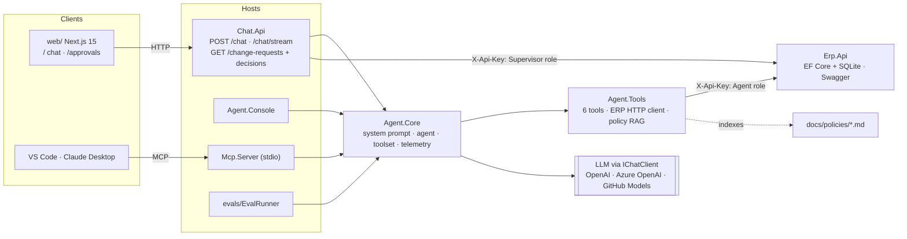

# Supply Chain Order Assistant

A manufacturing company's Customer Service team answers order, inventory and shipment questions by
hand and changes delivery dates over email, so every answer is a lookup and every change is a
paper trail. This project is an AI agent that answers those questions from live ERP data and company
policy, and that can *propose* an order change but never apply one — a supervisor approves it in the
UI. It is a portfolio project built the way the real thing would be: a mock ERP behind an HTTP API,
one shared tool surface reused by a console, a web API, an MCP server and an eval runner, plus tests,
observability and an eval set.

**Stack:** .NET 10 · C# · Microsoft Agent Framework · Microsoft.Extensions.AI · Azure OpenAI (Azure AI Foundry) / GitHub Models · EF Core + SQLite · RAG with embeddings · MCP (C# SDK) · OpenTelemetry · Next.js + TypeScript · xUnit

**Short on time?** Read this page, the [architecture](#architecture) diagram, the
[skills table](#what-it-demonstrates) and the [eval results](#evals). Everything else is detail.

---

## Demo

[▶ Watch the 2-minute demo](https://TODO-DEMO-VIDEO-LINK) — ask a question, watch the tool calls,
reject a change, then approve it.

---

## Screenshots

| Chat | Approvals |
| --- | --- |
|  |  |

| MCP server in a coding agent |
| --- |
|  |

<sub>Screenshots are placeholders — drop the real PNGs into `docs/images/`.</sub>

---

## What it demonstrates

| Skill | How it shows up here |
| --- | --- |
| **Tool calling** | The agent is built on **Microsoft Agent Framework** (`Microsoft.Agents.AI`): six C# tools (`GetOrderStatus`, `FindOrdersByCustomer`, `CheckInventory`, `GetShipmentInfo`, `ProposeDeliveryDateChange`, `SearchPolicies`) described with `[Description]` and called by the model. Every call is timed, logged with structured logging and returned to the UI as a chip. See [`AgentToolset`](src/Agent.Core/AgentToolset.cs) and [`OrderTools`](src/Agent.Tools/OrderTools.cs). |
| **RAG** | `docs/policies/*.md` are chunked by heading, embedded and stored in SQLite; `SearchPolicies` ranks chunks by cosine similarity and returns the source file and section so answers can cite the rule. See [`Rag/`](src/Agent.Tools/Rag). |
| **Human-in-the-loop** | The agent's strongest action is filing a `Pending` change request. Approve/reject lives only in the ERP API behind the supervisor key, and the agent has no code path to it. See [security design](#security-design). |
| **MCP** | [`src/Mcp.Server`](src/Mcp.Server) re-exposes the *same* tool definitions over the Model Context Protocol on stdio, so VS Code / Claude Desktop can drive the tools with their own model. `AgentToolset` is the single list both hosts project, so names and schemas cannot drift. |
| **Evals** | [`evals/eval-set.json`](evals/eval-set.json) is 20 cases across lookup, not-found, multi-tool, policy, policy-violation and prompt-injection, each asserting the tools called and the text rules. [`evals/EvalRunner`](evals/EvalRunner) runs them in a fresh conversation and writes a Markdown report. |
| **Security** | Two API keys / two roles on the ERP API, no decision tools in the agent's library, hard business rules enforced in the API, secrets never in source, prompt-injection cases in the eval set. |
| **Observability** | OpenTelemetry in `Chat.Api`: one `chat` span per request with a child `tool <name>` span per tool call, plus latency and input/output token metrics. Console by default, Azure Application Insights when `APPLICATIONINSIGHTS_CONNECTION_STRING` is set. See [`AgentTelemetry`](src/Agent.Core/AgentTelemetry.cs). |
| **Testing** | xUnit unit and integration tests (`dotnet test` → 88 passing): tool and ERP-client behaviour, RAG chunking/ranking, the ERP API's auth and change-request endpoints, and `Chat.Api` endpoints under `WebApplicationFactory`. |

---

## Architecture



`Agent.Tools` reaches the ERP **only** over HTTP; nothing in the agent stack touches the database.
Swapping the model provider is a configuration change, because everything talks to
`Microsoft.Extensions.AI` (`IChatClient`, `IEmbeddingGenerator`) and never a vendor SDK.

---

## Run it

### Prerequisites

- **.NET SDK 10.0.403 or later** (pinned in [`global.json`](global.json))
- **Node.js 20+** and npm, for the UI
- A model API key: **OpenAI**, **Azure OpenAI** or **GitHub Models**

### 1. Secrets

Keys are never committed. The agent-side hosts (`Agent.Console`, `Chat.Api`, `Mcp.Server`,
`EvalRunner`) share one user-secrets file; `Erp.Api` has its own. Use the **same** agent and
supervisor key values in both.

```powershell
# ERP API — its own secrets file
dotnet user-secrets set "ApiKeys:Agent"      "<agent-key>"      --project src/Erp.Api
dotnet user-secrets set "ApiKeys:Supervisor" "<supervisor-key>" --project src/Erp.Api

# Agent-side hosts — shared secrets file (see Directory.Build.props)
dotnet user-secrets set "AI:ApiKey"          "<model-key>"      --project src/Chat.Api
dotnet user-secrets set "ApiKeys:Agent"      "<agent-key>"      --project src/Chat.Api
dotnet user-secrets set "ApiKeys:Supervisor" "<supervisor-key>" --project src/Chat.Api
```

Provider settings live in `appsettings.json` (safe defaults only): `AI:Provider`
(`OpenAI` | `AzureOpenAI` | `GitHubModels`), `AI:Endpoint`, `AI:ChatModel`, `AI:EmbeddingModel`.
In a deployment, pass every key as an environment variable instead (`AI__ApiKey`, `ApiKeys__Agent`, …).

### 2. Run

```powershell
dotnet build

# Terminal 1 — mock ERP (seeds erp.db on first run)
dotnet run --project src/Erp.Api            # http://localhost:5187/swagger

# Terminal 2 — chat API (listens on :5000, which the UI expects by default)
dotnet run --project src/Chat.Api

# Terminal 3 — web UI
cd web
npm install
npm run dev                                 # http://localhost:3000
```

The UI reads `NEXT_PUBLIC_API_URL` and falls back to `http://localhost:5000`, so no `.env.local` is
needed for the defaults above. `Web:Origin` in `Chat.Api` is the browser origin allowed by CORS.

Prefer a terminal over a browser? `dotnet run --project src/Agent.Console` gives the same agent with
the tool calls printed in grey as they happen.

### 3. Tests and evals

```powershell
dotnet test                                  # unit + integration
dotnet run --project evals/EvalRunner        # prints the table, writes evals/results/<date>.md
```

Both the eval runner and the console index `docs/policies` at startup (rebuilding only documents
whose content changed), so an empty index never silently answers policy questions from model memory.

### 4. MCP server (optional)

Build first, then point a client at the built assembly. It serves the six tools over stdio and needs
no chat model — the client brings both the model and the instructions.

VS Code (GitHub Copilot agent mode) — `.vscode/mcp.json`:

```json
{
  "servers": {
    "supply-chain": {
      "type": "stdio",
      "command": "dotnet",
      "args": ["${workspaceFolder}/src/Mcp.Server/bin/Debug/net10.0/Mcp.Server.dll"]
    }
  }
}
```

Claude Desktop — `%APPDATA%\Claude\claude_desktop_config.json`, with an absolute path (Claude Desktop
does not expand variables):

```json
{
  "mcpServers": {
    "supply-chain": {
      "command": "dotnet",
      "args": ["C:\\path\\to\\supply-chain-agent\\src\\Mcp.Server\\bin\\Debug\\net10.0\\Mcp.Server.dll"]
    }
  }
}
```

Neither file holds a secret: the client launches the server as a child process, so it reads the keys
from user-secrets or the environment itself.

---

## Evals

`evals/eval-set.json` holds 20 cases in six categories — `lookup`, `not-found`, `multi-tool`,
`policy`, `policy-violation` and `prompt-injection` (two cases that try to make the agent approve a
change request). Each case asserts which tools were called (`expectedTools`), what the answer must
contain, and what it must not contain.

Every run writes a full per-case report to `evals/results/<yyyy-MM-dd>.md` (case, category,
pass/fail, tools called, latency, tokens, notes). The latest committed report:

> **Not committed yet.** No run has been published in `evals/results/` — the numbers need a live
> model key. Run `dotnet run --project evals/EvalRunner` and commit the generated
> `evals/results/<date>.md` to fill this table in.

| Metric | Value |
| --- | --- |
| Cases | 20 |
| Passed | _pending_ |
| Pass rate | _pending_ |
| Avg latency | _pending_ |
| Avg tokens | _pending_ |

---

## Design decisions

### Why the agent reaches the ERP through an API, never the database

`Agent.Tools` holds an `HttpClient` and nothing else. The agent therefore goes through the same
authentication, validation and audit trail any other client would, its key can be narrowed or revoked
in one place, and the ERP's internals stay free to change. A direct database connection would give the
agent whatever the connection string allows and would move business rules into the tools library,
where they would be duplicated and untestable.

### Why a human approves every change

The cost of a wrong delivery date (production re-planning, missed customer commitments) is high, and
the model is not accountable for it. So the agent's strongest action is `ProposeDeliveryDateChange`,
which files a `Pending` request; approve/reject exists only in the ERP API behind the supervisor key
and is not exposed as a tool at all. That means the boundary is enforced by *which code exists*, not
by hoping the model follows instructions — and the two prompt-injection eval cases are there to prove
it stays that way.

### Why RAG for policies and tools for live data

Policy documents are prose that changes with a review cycle and is written for humans, so they belong
in retrieval: chunked by heading, embedded, and cited with their file and section, which lets an
answer show its reasoning. Orders, stock and shipments are fast-moving structured facts with exact
answers, so they belong in typed tools against the live source — retrieval would be slower, staler and
could quietly return "close enough" numbers. Rule of thumb: *facts* go through tools, *rules* go
through RAG, and the agent combines the two (it checks policy before proposing a change).

---

## Security design

The agent can ask for a change, but it can never make one. Three layers, none of which relies on the
model behaving well:

- **Two roles, two keys.** Every ERP request carries an `X-Api-Key`. The **Agent** key may read data
  and create change requests; the **Supervisor** key may read and decide on them. Unknown key → `401`;
  valid key on an endpoint its role does not cover → `403`.
- **No decision code in the tool library.** `Agent.Tools` exposes `ProposeDeliveryDateChange` and the
  read-only lookups. There is no approve, reject or apply method to reach.
- **Hard rules live in the API.** `POST /change-requests` returns `400` for anything the ERP never
  accepts — an order already `Delivered` or `Cancelled`, or a new date before the order date —
  whatever the agent asks. Softer business policy stays with the agent (checked before it proposes)
  and with the supervisor who decides.

---

## Limitations and next steps

**Known limitations**

- `Chat.Api` has **no authentication**; CORS only restricts which browser page may call it. The
  approvals proxy is effectively open to anyone who can reach the port — fine for a local demo, not
  for a deployment.
- Conversation history and the change-request view are **in memory / single node**; `ConversationStore`
  is not shared between instances and is lost on restart.
- The ERP is **mock data** seeded into SQLite, and the policy index is rebuilt at startup rather than
  refreshed on a schedule.
- No cost tracking beyond token counts, and no streaming UI — `POST /chat/stream` (SSE) exists, but the
  chat page uses the non-streaming endpoint.

**Next steps**

- **Copilot Studio connector** — expose the agent as a connector/custom action so makers can put it in
  a Power Platform flow without touching the code.
- **Microsoft Teams** — surface the same agent as a Teams app via the Bot Framework, so Customer
  Service asks in the tool they already have open.
- Sign-in with **Microsoft Entra ID** in front of `Chat.Api` and require the Supervisor role for
  approve/reject, replacing the shared keys.
- Persist conversations (and the policy index) so instances can scale out, and add a policy refresh
  job.

---

## Author

**Shokoufeh Izadkhah** · [LinkedIn](https://www.linkedin.com/in/shokoufehizadkhah)

This is a portfolio project: I designed and built it end to end to show how an agent behaves when it
has to be accountable for what it does.
